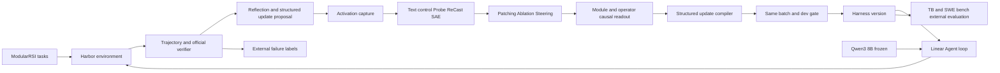

# Agent RSI 任务书与代码框架对应及整体方案

## 模型决定

主机制模型使用 `Qwen/Qwen3-8B`，规模复现使用 `Qwen/Qwen3-14B`。两者都是标准 dense decoder Transformer，可直接访问逐层 residual、attention 和 MLP，并与当前 `HFBackend` 的 `model.model.layers` Hook 结构匹配。`Qwen/Qwen3.5-9B` 仅作为系统层架构迁移模型：加载已经冻结的 Harness，检查行为收益是否迁移；不把它的 Gated DeltaNet 与混合注意力层和 Qwen3 的标准注意力层直接做因果位置比较。Qwen3-Coder 480B-A35B、Qwen3-Coder-Next 和其他 MoE 模型不进入首轮白盒机制实验。

近期与本课题最接近的研究反复使用 Qwen3-8B：EvoHarness-RL、HarnessForge、多 Harness RL 和 Harness Policy Distillation 都以它作为主要或关键骨干；Qwen3-14B 已有多 GPU 全层激活追踪与 steering 的复现实例。因此选择 Qwen3-8B 不是退回旧模型，而是在前沿使用频率、白盒可干预性和学校算力之间取得平衡。

## 任务书与当前代码对应

| 任务书部分 | 要回答的问题 | 当前文件 | 完成度 | 当前限制与下一步 |
|---|---|---|---|---|
| 2.1 RSI 形式化与 Improvement State | `任务→轨迹→反馈→反思→更新→下一版本` 如何记录 | `rsi/contracts.py`、`rsi/environment.py`、`rsi/__main__.py` | 部分完成 | 已有统一 Episode、失败标签、提案和版本数据类；真实 Harbor 轨迹尚未转换为这些结构 |
| 2.2 多粒度状态采集 | 哪个 Token、层和组件形成改进信息 | `rsi/backends.py` | 原型完成 | 已支持 residual、attention、MLP Hook 和阶段边界；目前只在合成调用模板上运行，需改成逐 Agent model call，并增加分片 safetensors 写入 |
| 2.3 Probe 与 SAE | 内部表示能否解码结果、定位、归因和更新选择 | `rsi/analysis.py`、`rsi/sae.py` | 原型完成 | 已有文本控制和逐层 Logistic Regression；本地 SAE 只适合冒烟测试，正式实验改用 SAELens；ReCast 尚未实现 |
| 2.4 状态形成轨迹 | 信息何时出现并如何跨 Token 发展 | `rsi/analysis.py` 的阶段读出 | 部分完成 | 已有 feedback、反思 25/50/75/100%、reflection end、proposal；需加入逐 Token 曲线、首次可解码位置、同义反思和反事实反馈配对 |
| 2.5 因果干预 | 候选状态是否真正改变更新决策 | `rsi/backends.py`、`rsi/analysis.py`、`rsi/__main__.py` | 原型完成 | 已有 donor、自替换、等范数随机、方向 steering 和更新回放；需补 sequential patch、zero/mean/direction ablation、dose response 及真实五模块 proposal 读出 |
| 2.6 跨轮次更新 | 内部效应怎样通过外部工件持续到下一轮 | `environment.assess_update()`、`stream.jsonl` 输出逻辑 | 合成环境完成 | 已验证接受、拒绝、版本和实际重输入；真实五模块 compiler、回滚和 Harbor 重跑尚未实现 |
| 2.7 系统实现 | 执行、采集、解码、干预、版本管理如何协作 | `rsi/__main__.py` | toy 闭环完成 | 真实执行器尚未接 Harbor；当前入口仍围绕购物篮合成环境 |
| 系统基线 | H0、反思、GEPA、AutoSaddler、Ours 如何公平比较 | `rsi/baselines.py`、`rsi/baseline_suite.py`、`docs/baseline_protocol.md` | 简化对照完成 | 当前 GEPA、ReasoningBank、Gödel、DGM 都是行为近似，不是官方实现；正式论文只保留 H0、Text Reflection、官方 GEPA、AutoSaddler-style、Ours |
| 机制基线 | 文本、Probe、ReCast、随机/顺序 patch、消融/steering | `rsi/analysis.py`、`rsi/sae.py` | 约一半完成 | 文本控制、Probe、随机和单点干预已有；ReCast、顺序 patch、完整消融和特异性评价待补 |
| 数据与评测 | InterCode、ModularRSI、TB、SWE-bench 如何接入 | `configs/real_pilot.json`、`configs/formal_study.json`、实施文档 | 方案完成、代码未接 | 需要 Harbor Agent、trial 转换器、SWE-bench prediction exporter 和官方评分命令封装 |
| 复现与统计 | 切分、版本、置信区间和预算如何固定 | configs、manifest、`summarize_interventions()` | 部分完成 | 已有 task-cluster bootstrap 和版本元数据；需补 McNemar、paired permutation、三 evolution seed 汇总和 Docker/model/data digest 锁定 |

## 当前代码的真实层次

### 第一层 合成机制验证

`environment.py` 产生四类购物篮条件，`ToyBackend` 人为编码状态，`__main__.py` 跑完 Probe、干预、更新验收和跨轮版本流。这一层用于证明数据管线和因果实验程序没有接线错误，不产生论文结论。

### 第二层 白盒模型原型

`HFBackend` 已能加载 Qwen/Llama 风格模型，通过原生 PyTorch Hook 读取和替换选定层的 residual、attention 与 MLP 输出。它当前把反思和 A-D 决策写在一个合成模板中，还不是完整 Agent loop。

### 第三层 真实 Agent 实验合同

`contracts.py`、`real_pilot.json` 和 `formal_study.json` 已规定 ModularRSI 任务、Harbor runtime、五个 Harness 模块、结构化更新操作、激活阶段、基线及评测指标。这一层定义已经较完整，但没有执行适配器。

### 第四层 待实现真实运行层

需要新增：

- `rsi/adapters/harbor_agent.py`：模型在容器外推理，命令在 Harbor 环境内执行；
- `rsi/adapters/harbor_records.py`：trial、trajectory、reward、verifier 转为 `EpisodeRecord`；
- `rsi/harness/schema.py`：五模块内容、哈希和作用域；
- `rsi/harness/compiler.py`：九种结构化操作生成确定性文本或受控 diff；
- `rsi/evolution/version_store.py`：父子版本、验收、回滚和冻结；
- `rsi/baselines/gepa_adapter.py`：官方 GEPA adapter；
- `rsi/baselines/autosaddler_scenario.py`：ModularRSI/Harbor scenario plugin；
- `rsi/eval/swebench.py`：输出 predictions 并调用官方 evaluator；
- `rsi/eval/statistics.py`：任务级配对统计；
- `rsi/mechanism/recast.py` 和 `sequential_patch.py`：补齐机制基线。

## 整体实验架构

## 两条实验主线

### 主线 A 内部机制实验

固定 H0、Qwen3-8B 和任务输入，收集同任务成功与失败 rollout。外部 verifier 和受控差异产生四类功能标签：结果评估、错误定位、原因归因、更新选择。先用文本分类器确定外显信息上限，再做逐层逐 Token Probe。Probe 只负责定位候选站点；随后用 patch、消融和 steering 检查目标模块和更新操作是否按预期改变。主结论来自任务隔离的 test split 和随机对照校正后的因果效应。

该主线训练和选择期间不改变 Harness，避免版本变化导致激活分布漂移。完成候选机制定位后，才进入主线 B。

### 主线 B Harness 改进与 RSI 验证

H0、Text Reflection、GEPA、AutoSaddler-style 和 Ours 使用同一任务、seed、policy token、候选数、verifier 次数和 dev 访问预算。Ours 只比 AutoSaddler-style 多使用经过主线 A 验证的机制信号，候选仍须通过相同 same-batch 与 dev gate。被接受的子 Harness 才能执行后续任务并生成下一代证据；这样版本链才构成递归改进，而单次离线优化只报告为 harness offline learning。

## 数据和切分

Pilot 使用 ModularRSI terminal train 中分层抽取的 30 题，每题 4 个 rollout，只检查执行、记录、配对和编译。正式实验在 terminal 与 SWE 两个领域分别把官方 120 个演化任务固定为 80 evolve、20 dev、20 internal held-out，每题 5 个 rollout，运行 3 个独立 evolution seed。最终冻结 Harness 后，在 Terminal-Bench 2.1 和 SWE-bench Verified 上做一次外部评测。InterCode 只保留为适配器冒烟测试。

## 模型与推理控制

- 主模型：`Qwen/Qwen3-8B`；
- 规模复现：`Qwen/Qwen3-14B`；
- 架构迁移：`Qwen/Qwen3.5-9B`，只做系统行为迁移；
- 参数冻结，BF16；
- thinking 与 non-thinking 必须固定成两个预注册实验臂，不能在运行中自动切换；
- 主机制实验使用确定性或预注册采样参数，同一配对共享 seed；
- 模型、Tokenizer、Transformers、Torch、CUDA 和权重 revision 全部固定。

## 论文最小可发表闭环

第一阶段只完成 terminal domain：30 题 pilot、120 题机制实验、五个系统基线、Qwen3-8B、Linear Probe、单点/顺序 patch、消融与 steering、TB 外部评测。第二阶段再加入 SWE、Qwen3-14B、ReCast、SAELens 和 Qwen3.5-9B 迁移。这样即使第二阶段算力不足，第一阶段仍能回答任务书的核心科学问题。

## 近期实施优先级

1. Harbor `BaseAgent` 与 `EpisodeRecord` 转换器；
2. 五模块 schema、compiler、version store；
3. 30 题 H0 rollout 与激活分片；
4. 文本控制、Linear Probe、覆盖率统计；
5. sequential patch、完整 ablation 和 causal specificity；
6. 官方 GEPA 与 AutoSaddler scenario；
7. 正式 80/20/20 实验；
8. TB 和 SWE-bench 外部冻结评测；
9. Qwen3-14B 与 Qwen3.5-9B 复现。